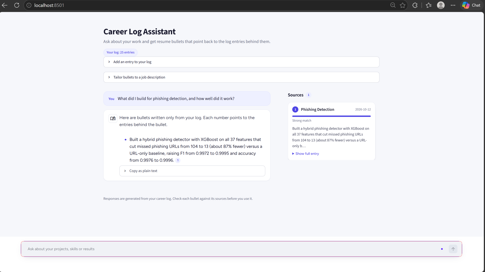

# Career Log Assistant



Turn a personal career log into resume bullets you can trust. You keep short, factual log entries. Ask a question or paste a job description, and the app writes bullets using only those entries. Every bullet carries numbered citations to the entries behind it, and any bullet with a number or risky word that its sources do not contain is flagged.

A weekly Telegram check-in (via n8n) makes the log easy to keep up.

## What it does

- **Ask your log.** "What are my strongest machine learning projects for a resume?" returns bullets with citations, and the source entries appear as cards beside the chat.
- **Tailor to a job description.** Paste a job description. It is reduced to the skills it asks for, your log is searched for each one, and bullets are written from the matching entries.
- **Check every bullet.** Numbers and risky words (pipeline, deployed, SQL and so on) must appear in the cited entries, or the bullet is marked "Check before using this bullet". Each bullet cites at most three entries.
- **Add entries.** A form in the app, or a weekly Telegram reply, appends to the log and the search index.

## How it works

```
log entries (data/log.jsonl)
        |
        v
Chroma search index  -->  retrieve matching projects
                                  |
                                  v
                    LLM writes one bullet per project
                                  |
                                  v
        tighten citations + check numbers and risky words
                                  |
                                  v
            Streamlit chat with source cards and warnings
```

## Evaluation

`eval/run_eval.py` runs a set of test requests against the generator. Requests the log covers should return bullets whose numbers and wording are supported by the cited entries. Requests the log does not cover (for example Kubernetes) should return no bullets. Results and their limits are in [`eval/RESULTS.md`](eval/RESULTS.md).

## Run it

From the project root:

```bash
pip install -r requirements.txt
streamlit run app/app.py
```

Then open <http://localhost:8501>. Run it from the project root so Streamlit finds `.streamlit/config.toml`.

With no log or API key, the app uses built-in sample data. The chip under the title says **Sample data**, so a demo never passes sample bullets off as real ones.

## Use your own log

The app switches to your real log when all of these are true:

1. `src/careerlog` is importable and `data/log.jsonl` has entries.
2. `.env` contains `GROQ_API_KEY` and `GROQ_MODEL` (copy `.env.example`).

Entries can be added in the app, with the CLI (`python -m careerlog add ...`), or by a bulk import. New entries are added to the search index the next time the app answers. To rebuild the index by hand: `python -m careerlog index`.

To force a mode, set `CAREERLOG_BACKEND` to `sample` or `live`.

## Weekly check-in with Telegram and n8n

Two n8n workflows keep the log up to date:

1. **Reminder.** A schedule trigger (Sundays, 6 pm) sends you a Telegram message asking what you did this week.
2. **Replies.** Every 10 minutes a workflow reads new messages from your Telegram chat, sends each to a small local service, and replies with what happened. Import `n8n/checkin-replies.workflow.json`.

Reply in this format:

```
project | what you did this week
```

Setup:

1. Create a Telegram bot with @BotFather and find your chat ID.
2. Put `TELEGRAM_BOT_TOKEN`, `TELEGRAM_CHAT_ID` and a random `CHECKIN_TOKEN` in `.env`.
3. Start the check-in service from the project root: `python -m careerlog.api`. It listens on `127.0.0.1:8765` and only accepts requests with the token.
4. In n8n, import the workflow, fill the three values in its **Config** node, attach your Telegram credential to the **Send reply** node, and publish it.
5. Build the reminder with a Schedule Trigger and a Telegram "Send a text message" node.

Things to know:

- The workflow ignores messages from any chat except yours, and the service validates every entry (minimum length, no `[placeholders]`, duplicates ignored).
- n8n, the check-in service and your computer all have to be running at the scheduled time. If the laptop is asleep, that week's reminder is skipped.
- Telegram bot messages are not end-to-end encrypted. Keep passwords and personal details out of your check-ins.
- The **Config** node holds your tokens inside n8n. Do not export or share that workflow after filling it in.

## Project layout

| Path | What it does |
|---|---|
| `app/app.py` | The interface: chat, source cards, forms, styling. No retrieval logic. |
| `app/rag_backend.py` | `get_answer`, `get_job_answer`, entry helpers. Holds the sample data and the adapter to `src/careerlog`. |
| `src/careerlog/` | `schema`, `store`, `index` (Chroma), `generate` (prompting), `verify` (checks), `entry` and `jd` (validation), `api` and `textutil` (check-in service), `cli`. |
| `n8n/` | The workflow that reads Telegram replies. |
| `eval/` | Test requests, the evaluation script, and `RESULTS.md`. |
| `tests/` | Unit tests (`python -m pytest`). |
| `.streamlit/config.toml` | Light theme, primary colour `#4F46E5`. |

## Plug in a different backend

The interface only needs these from `rag_backend.py`:

- `get_answer(question)` and `get_job_answer(jd_text)`, both returning an `Answer`.
- `Answer.bullets`: a list of `Bullet(text, source_ids, issues)`. A non-empty `issues` list triggers the warning.
- `Answer.sources`: a list of `Source(id, project, date, text, score, note)` in citation order. Source 1 is the first one cited. `score` is 0 to 1, or `None`.
- `Answer.requirements`: in job mode, the terms that were searched for.

## Limits

- The checks catch invented numbers and a fixed list of risky words. They do not catch every vague overclaim, so read the sources.
- Bullets can only be as accurate as the entries behind them. Add a number to an entry only if you can see it in your own results.
- Questions, pasted job descriptions and entry text are sent to the language model provider (Groq). Do not paste anything you would not want to share.
- The test requests were written for this log, so they test this log, not resumes in general.
